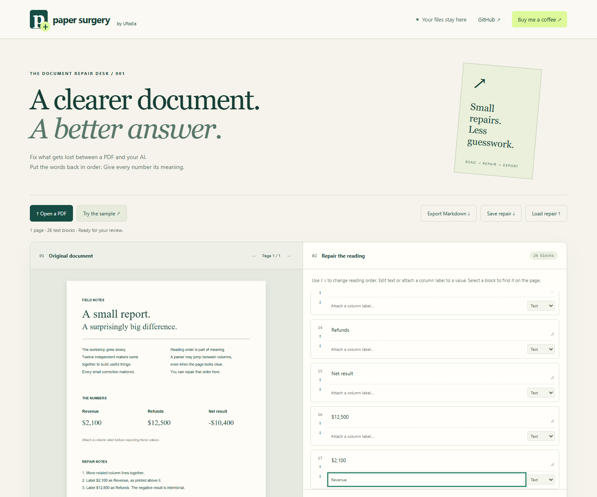

<p align="center"></p>

<p align="center">
  <a href="https://github.com/ufodia/paper-surgery/actions/workflows/ci.yml"></a>
  <a href="LICENSE"></a>
  
  
</p>

# Paper Surgery

**[Open the live app ↗](https://paper-surgery.vercel.app/)** · [Deployment guide](docs/DEPLOYMENT.md)

**A clearer document. A better answer.**

A PDF can look perfectly clear while its extracted text jumps between columns or separates a value from its table heading. Paper Surgery puts the original beside editable text blocks, so you can repair the input before handing it to an AI assistant.

<p><a href="https://buymeacoffee.com/ufodia"></a></p>

## See it in action



## What you can do

- Open and render real text-based PDFs locally with PDF.js.
- Locate every extracted block on its original page.
- Reorder blocks within a page, edit text, mark headings, and label table values.
- Export corrected Markdown with page provenance.
- Save and reload a validated repair bound to the exact PDF by SHA-256.

## Start locally

Requires **Node.js 24** and npm. No API key or account is required.

```sh
git clone https://github.com/ufodia/paper-surgery.git
cd paper-surgery
npm ci
npm run dev
```

Open the loopback URL printed by Vite. Then:

1. Choose **Try the sample** to open the included two-column workshop report.
2. Select a text block to highlight its original location. Use the up/down controls to restore a logical reading order.
3. Attach **Revenue** to **$2,100** and **Refunds** to **$12,500**, checking their printed column positions. Preserve the negative net result.
4. Choose **Export Markdown**, then **Save repair**. Reopen the same PDF and choose **Load repair** to reproduce your edits.

## Scope, honestly

- This version extracts selectable text. Scanned documents require OCR elsewhere first.
- Each PDF is limited to 40 MB and 100 pages. Reading order starts from PDF content order.
- Labels describe the user’s interpretation; the application does not verify arithmetic or claim to understand tables automatically.
- There is no automatic factuality score, model connection, or semantic correction.
- Work remains in tab memory until exported. Refreshing the page discards unexported edits.

## Documentation

| Read | What you will find |
| --- | --- |
| [User guide](docs/USER_GUIDE.md) | Complete workflow and troubleshooting |
| [File formats](docs/FORMATS.md) | Input/output contracts and examples |
| [Architecture](docs/ARCHITECTURE.md) | Modules and trust boundaries |
| [Privacy](docs/PRIVACY.md) | Where your data goes |
| [Development](docs/DEVELOPMENT.md) | Checks, builds, and restoring on a new computer |
| [Limitations](docs/LIMITATIONS.md) | Supported scope and review requirements |
| [Validation](docs/VALIDATION.md) | What was actually checked |

## Build and verify

```sh
npm run typecheck
npm test
npm run build
npm run preview
```

The production output is `dist/`. CI performs checks and a build; it does not deploy a website. See [Contributing](CONTRIBUTING.md), [Security](SECURITY.md), and the [Changelog](CHANGELOG.md).

## Support independent tools

If this saves you a frustrating round trip with AI, [buy Ufodia a coffee](https://buymeacoffee.com/ufodia). Support helps maintain examples, improve compatibility, and keep the core openly available. Bug reports, thoughtful feedback, and documentation fixes help too.

You can also [sponsor ufodia on GitHub](https://github.com/sponsors/ufodia).

## License and credits

[MIT](LICENSE) © 2026 **Ufodia**. Original UI, sample material, and repository artwork are included under the same license. Dependencies retain their own licenses; review their notices before redistribution.

## Browser checks

The real workbench flow is covered by [Playwright browser tests](docs/BROWSER_TESTS.md), including local exports and mobile layout. Run `npm run test:browser` after installing Chromium.
